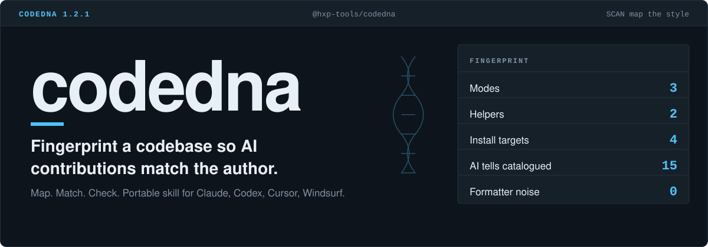
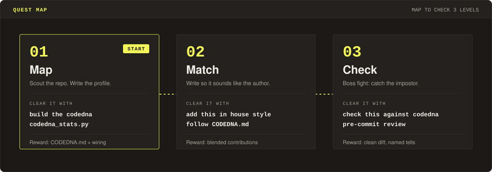
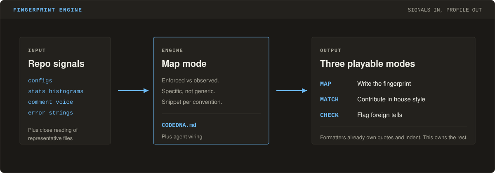
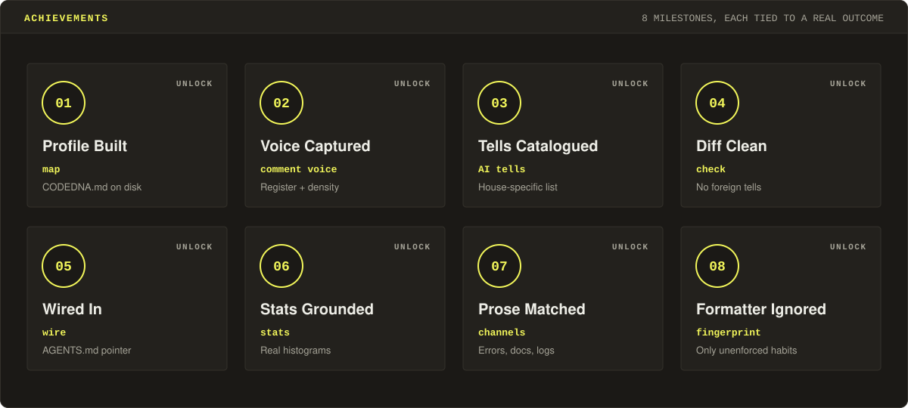

# codedna

[](https://github.com/hannsxpeter/codedna/actions/workflows/ci.yml)
[](https://github.com/hannsxpeter/codedna/releases)
[](https://www.npmjs.com/package/@hxp-tools/codedna)
[](LICENSE)



**Fingerprint a codebase so AI contributions match the author.**

Writes `CODEDNA.md` from the habits formatters cannot touch: naming, comments, errors, structure, idioms. Then Match and Check use that profile so new work blends in.

## Quest map



| Level | Mode | Clear it with | Reward |
| --- | --- | --- | --- |
| **01** | **Map** | "build the codedna for this repo" | `CODEDNA.md` + agent wiring |
| **02** | **Match** | "add this in the style of the repo" | Contributions that blend in |
| **03** | **Check** | "check this against the codedna" | Named tells before they ship |

If a repo has no profile yet, Map runs first. Match and Check refuse to invent a style.

## Fingerprint engine



1. **Configs** settle what tooling already enforces (Prettier, ruff, gofmt, and friends).
2. **Stats** ground the profile in real frequencies: naming casing, comment density, voice, error punctuation.
3. **Close reading** captures the habits numbers miss: verb dialect, extraction threshold, channel-specific prose.

Every convention in the profile is specific enough that it would read differently for a different codebase. Generic lines get sharpened or cut.

## Achievements



| Unlock | How you earn it |
| --- | --- |
| Profile Built | `CODEDNA.md` exists and is specific |
| Voice Captured | Comment register and density recorded |
| Tells Catalogued | House-specific AI tells listed |
| Diff Clean | Check finds nothing foreign |
| Wired In | `AGENTS.md` (or peer file) points at the profile |
| Stats Grounded | Histograms from the real corpus |
| Prose Matched | Errors, docs, and logs treated as channels |
| Formatter Ignored | Profile covers only unenforced habits |

## Press start

```sh
npx @hxp-tools/codedna@latest
```

Or pick a target: `npx @hxp-tools/codedna@latest cursor` (also `claude`, `codex`, `windsurf`, or `all`).

From source:

```sh
git clone https://github.com/hannsxpeter/codedna.git
cd codedna
./install.sh cursor   # or: all | claude | codex | windsurf
```

Restart the agent, then ask:

> build the codedna for this repo

Python 3.9+ is required for the helpers. Without Python, the agent still profiles from configs and close reading, and says so in the report.

Release tarball:

```sh
curl -L https://github.com/hannsxpeter/codedna/releases/download/v1.2.1/codedna-v1.2.1.tar.gz | tar xz
cd codedna-1.2.1
./install.sh codex
```

Install paths and wiring details: [docs/AGENT_SUPPORT.md](docs/AGENT_SUPPORT.md).

## What a first Map looks like

codedna reads linter and formatter configs, runs a stdlib-only stats pass, close-reads a representative sample, then writes a profile whose TL;DR looks like this:

```markdown
## TL;DR
1. Functions and variables are camelCase; types PascalCase; constants SCREAMING_SNAKE.
2. Comment only the non-obvious why. Most functions have no comment.
3. Errors are terse `throw new Error("...")`. No custom error classes.
4. Functions are small (median ~9 lines); repetition is tolerated over premature abstraction.
5. Comments are short sentence fragments; error strings are lowercase and omit terminal punctuation.
```

Then it points the repo's agent instruction files at that profile so Match and Check actually load it.

## Running the helpers directly

```sh
python3 skill/scripts/codedna_stats.py /path/to/repo
python3 skill/scripts/codedna_stats.py /path/to/repo --json
python3 skill/scripts/codedna_wire.py /path/to/repo
python3 skill/scripts/codedna_wire.py /path/to/repo --all
```

The stats helper only reads. Inside a Git work tree it measures files Git would track. The wiring helper reports each file as `created`, `updated`, or `unchanged`.

Optional pre-commit hook (prints a review, never blocks):

```sh
cat > .git/hooks/pre-commit <<'HOOK'
#!/usr/bin/env sh
git diff --staged | claude -p "check this staged diff against the codedna" || true
HOOK
chmod +x .git/hooks/pre-commit
```

## What it captures

- **Naming**: casing, verb dialect (`get` vs `fetch` vs `load`), abbreviations, boolean prefixes
- **Comments and docs**: density, why-vs-what, register, doc-comment norms
- **Prose by channel**: errors, validation, logs, test descriptions, CLI or UI text, repository docs
- **Structure and control flow**: function size, extraction threshold, early returns, async style
- **Error handling**: defensiveness, custom types, message tone
- **Idioms**: reused helpers and domain vocabulary
- **AI tells**: where this author is the opposite of the AI default

## Contributing

See [CONTRIBUTING.md](CONTRIBUTING.md). Ground rules: [CODE_OF_CONDUCT.md](CODE_OF_CONDUCT.md).

## License

[MIT](LICENSE).
